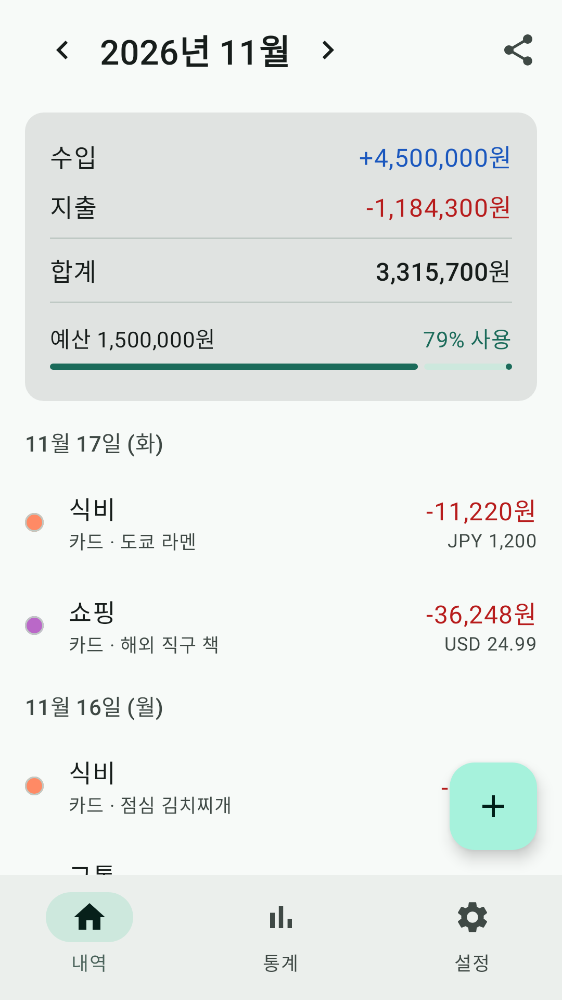
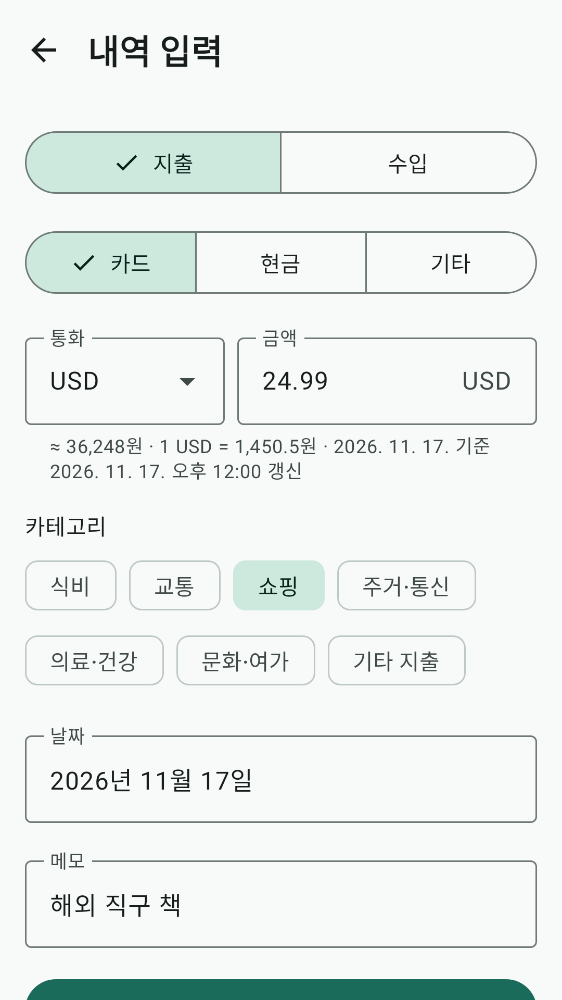
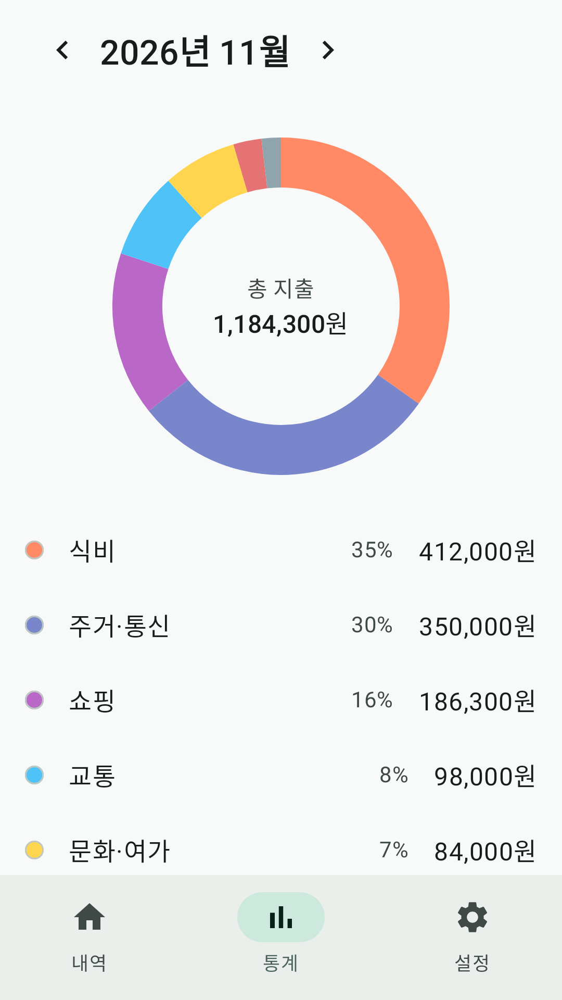
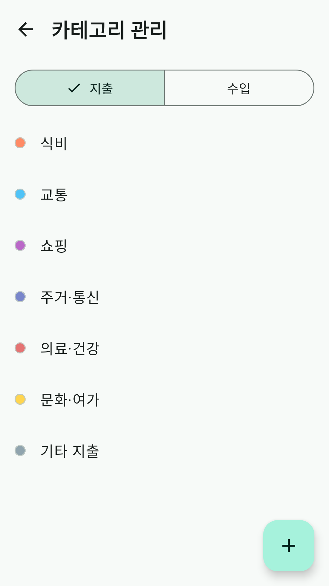
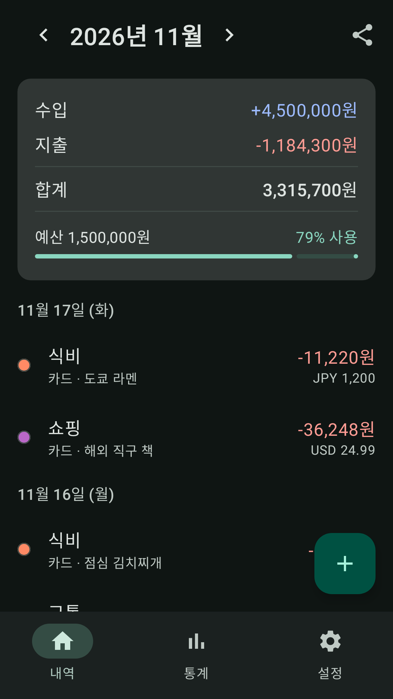
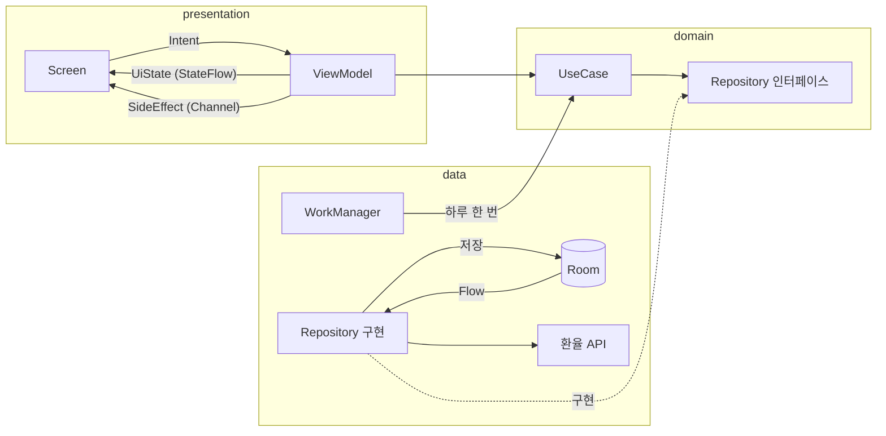

<p align="center">
  
</p>

<h1 align="center">CashNote</h1>

<p align="center">
  회원가입 없이 바로 쓰는 오프라인 우선 가계부 Android 앱<br/>
  외화 지출은 한국수출입은행 환율로 자동 환산하고, 데이터는 내 기기에만 저장합니다.
</p>

<p align="center">
  <!-- 출시 후 Play 스토어 링크로 교체 -->
  <a href="#">Google Play (출시 예정)</a> ·
  <a href="https://namhs-dev.github.io/CashNote/privacy-policy">개인정보처리방침</a>
</p>

## 스크린샷

| 월별 내역 | 외화 입력 | 통계 | 카테고리 관리 | 다크 모드 |
|---|---|---|---|---|
|  |  |  |  |  |

스크린샷은 기기 없이 Roborazzi로 렌더링해 생성합니다 (`app/src/test/.../store`).

## 주요 기능

- **내역 기록**: 금액, 카테고리, 결제수단(현금·카드·기타), 날짜, 메모. 월 수입·지출 합계, 밀어서 삭제와 실행 취소
- **외화 지출 자동 환산**: 통화와 외화 금액을 입력하면 저장 시점 환율로 원화 환산, 원금액·적용 환율을 함께 보관
- **환율 동기화**: WorkManager로 하루 한 번 갱신, 오프라인이면 마지막 환율과 갱신 시각 표시
- **통계**: 카테고리별 지출 도넛 차트와 비율
- **예산과 알림**: 월 예산 80%·초과 알림, 매일 기록 리마인더
- **카테고리 관리**, **CSV 내보내기**, **다크 모드**
- 회원가입·광고 없음. 가계부 데이터는 서버로 보내지 않음

## 기술 스택

| 분야 | 사용 기술 |
|---|---|
| 언어·UI | Kotlin, Jetpack Compose (Material 3), Navigation Compose (type-safe) |
| 아키텍처 | MVI + Clean Architecture (presentation / domain / data), 단일 `:app` 모듈 |
| DI | Hilt |
| 로컬 저장소 | Room (Single Source of Truth), DataStore |
| 네트워크 | Retrofit, OkHttp, kotlinx.serialization |
| 비동기 | Coroutines, Flow |
| 백그라운드 | WorkManager |
| 모니터링 | Firebase Crashlytics |
| 테스트 | JUnit, kotlinx-coroutines-test, Turbine, Room 계측 테스트, Robolectric, Roborazzi |
| 품질·CI | ktlint, GitHub Actions (ktlint·빌드·단위 테스트, PR 제목 규칙 검사) |

minSdk 26 · targetSdk 37

## 아키텍처



- **UI는 Room Flow만 구독합니다.** 네트워크 응답은 먼저 Room에 저장되고, 화면은 DB 변경을 따라 갱신됩니다. 그래서 오프라인에서도 같은 화면이 그대로 동작합니다.
- **MVI**: 화면마다 `UiState`(불변) / `Intent` / `SideEffect` Contract를 두고, 공통 `MviViewModel`이 `StateFlow`와 `Channel`을 관리합니다. Composable은 ViewModel을 연결하는 Route와 상태만 받는 Screen으로 나눠 Preview와 테스트를 쉽게 했습니다.
- **domain은 순수 Kotlin**입니다. Android·Room·Retrofit에 의존하지 않고, 변환은 data 계층의 mapper에서만 합니다.

```
com.namhs.cashnote
├─ data/          # local(Room), remote(Retrofit), repository, worker, notification, file(CSV), network(연결 상태)
├─ domain/        # model, repository 인터페이스, usecase
├─ presentation/  # 화면별 Screen·ViewModel·Contract, theme, navigation
└─ di/            # Hilt 모듈
```

## 기술적 고민

**금액은 `Long`(원 단위), 외화는 `BigDecimal`**
부동소수점 오차를 피하려고 원화는 정수로, 외화 원금액과 환율은 `BigDecimal`로 저장합니다. 외화 거래에는 저장 시점의 적용 환율을 함께 남겨, 나중에 환율이 바뀌어도 과거 기록의 원화 금액이 변하지 않습니다.

**스키마 변경과 마이그레이션**
`exportSchema`로 버전별 스키마를 저장소에 남기고, 외화·결제수단 등 필드 추가는 Room `AutoMigration`(v1 → v5)으로 처리했습니다. 기존 사용자 데이터를 지우는 `fallbackToDestructiveMigration`은 쓰지 않습니다.

**알림은 AlarmManager가 아니라 WorkManager**
리마인더는 정확한 시각이 필요하지 않고, Android 14부터 정확한 알람 권한이 기본으로 거부됩니다. 재부팅 후에도 예약이 유지되는 WorkManager로 하루 단위 예약을 했습니다.

**카테고리 삭제는 외래 키 `RESTRICT`**
거래가 남아 있는 카테고리를 지우면 기록의 의미가 사라지므로, DB 수준에서 삭제를 막았습니다.

**자동 백업 범위 지정**
백업 규칙에 거래 DB와 설정만 포함하고, CSV 내보내기 파일과 Firebase 설치 식별 파일은 제외했습니다. 클라우드 백업은 종단간 암호화가 가능한 기기에서만 동작합니다.

**edge-to-edge와 키보드**
`enableEdgeToEdge()` 환경에서는 `adjustResize`가 화면 크기를 줄이지 않아, 입력 화면에 `imePadding()`을 적용해 메모 입력창이 키보드에 가려지지 않게 했습니다.

## 빌드 방법

1. [한국수출입은행 Open API](https://www.koreaexim.go.kr)에서 환율 API 인증키를 발급받아 `local.properties`에 추가합니다.
   ```properties
   EXCHANGE_RATE_API_KEY=발급받은키
   ```
2. Firebase 콘솔에서 받은 `google-services.json`을 `app/`에 둡니다. (저장소에는 포함하지 않습니다.)
3. 빌드와 테스트
   ```bash
   ./gradlew assembleDebug
   ./gradlew testDebugUnitTest
   ./gradlew connectedDebugAndroidTest   # 기기 연결 필요
   ```

## 개발 방식

- GitHub Issues·Milestones로 기능 단위 계획 (M0 셋업 → M6 출시 준비)
- `feature/<이슈번호>-<설명>` 브랜치 → `dev` squash merge → `main` 릴리스
- 커밋·PR 제목은 `<type>: <설명>` 규칙, CI에서 검사
- AI 코딩 도구(Claude Code)를 함께 사용했습니다. 이슈마다 설계 방향과 범위를 정해 작은 단위로 맡기고, 모든 변경은 직접 검토한 뒤 커밋했습니다. 아키텍처와 코드 규칙은 [CLAUDE.md](CLAUDE.md)에 정리해 일관성을 유지했습니다.

## 앞으로의 계획

- v1.1: 온보딩, 인앱 업데이트, 통계 기간 선택, 테마 설정, 앱 바로가기
- v1.2: 반복 거래와 결제일 알림, 홈 화면 위젯
- 이후: 자산관리, 선택형 로그인과 클라우드 동기화

자세한 내용은 [Milestones](https://github.com/namhs-dev/CashNote/milestones)에서 볼 수 있습니다.
